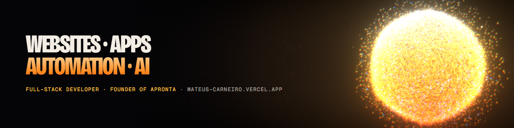

## Mateus Carneiro

Full-stack developer from Aveiro, Portugal. I build websites, web apps, automations and AI tools that run in production.

- **Construir Portugal**: monthly development contract. Public site, Node.js/Fastify backend, admin panel connected to the Moloni ERP, an AI assistant and the team's internal tools.
- **APRONTA**: I founded a studio for websites, online stores, apps and automation.
- **My own products**: TteusCode, a desktop workspace for coding agents (Tauri + React), and TteusPrime, a training and nutrition PWA (Next.js + Firebase).

### Live work

| Project | What it is | Stack |
| --- | --- | --- |
| [Construir Portugal](https://construirportugal.pt) | Construction marketplace: site, backend and AI | JavaScript · Supabase · Node.js · Docker |
| [APRONTA](https://apronta.pt) | My studio's website | HTML · Supabase · Playwright |
| [Domus Tattoo Art](https://domus-tattoo.vercel.app) | Client landing page | HTML · CSS · JavaScript |
| [Auto B.F. Gadelha](https://auto-bf-gadelha.vercel.app) | Client landing page | HTML · CSS · JavaScript |
| [TteusCode](https://tteuscode-landing.vercel.app) | Desktop app for coding agents | Tauri 2 · React · TypeScript |
| [$APRT Cédula](https://token-apronta.vercel.app) | WebGL brand site (demo, fictional token) | three.js · GSAP |
| [Difusor](https://difusor.vercel.app) | Telegram → Discord automation (demo) | JavaScript · GSAP |

### Stack

TypeScript · JavaScript · React · Next.js · Node.js · Fastify · Supabase · PostgreSQL · Tailwind CSS · three.js · React Three Fiber · GSAP · n8n · Docker · Vercel · Cloudflare · Playwright · Vitest

Most of my code lives in private client and company repositories.

### Contact

[Website](https://mateus-carneiro.vercel.app) · [LinkedIn](https://www.linkedin.com/in/mateus-carneiro-dev/) · mateuscarneiroslb20@gmail.com

PT · Estudo Gestão e Programação de Sistemas Informáticos em Oliveira do Bairro e trabalho em projetos reais ao mesmo tempo. Aberto a projetos e a propostas de trabalho.
